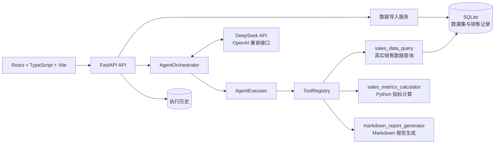

# AgentFlow——智能销售数据分析 Agent 平台

GitHub 仓库：[FaustQAQ/AgentFlow-Sales-Analytics](https://github.com/FaustQAQ/AgentFlow-Sales-Analytics)

## 项目简介

AgentFlow 是一个面向真实销售明细数据的可观测 AI 应用。用户上传 CSV/XLSX 文件后，系统完成文件解析、字段映射、数据校验和 SQLite 持久化；用户选择数据集并提交自然语言分析任务，DeepSeek 通过 OpenAI 兼容 API 和 Function Calling 自主选择业务工具，Python 后端负责参数校验、数据库查询、确定性指标计算和 Markdown 报告生成。

项目重点解决两个问题：一是让销售分析从代码内置数据转变为基于用户上传数据的真实查询；二是让 Agent 的工具调用、计算过程和最终结果可追溯。LLM 负责理解任务和编排工具，关键业务数字由 Python 与 SQLAlchemy 计算，避免让模型直接推导销售金额或增长率。

## 核心功能

- CSV/XLSX 销售文件上传
- 文件解析、表头识别与字段映射
- 日期、金额、数量、空值、重复订单和异常行校验
- 导入预览、失败行定位与导入统计
- 多数据集管理、详情查询和销售记录分页查询
- 基于 `dataset_id` 的数据隔离
- DeepSeek Function Calling
- Agent 多轮工具调用与任务编排
- 销售总额、同比和环比计算
- 产品销售排名与地区销售排名
- Markdown 分析报告生成
- 执行历史、工具参数、工具输出和最终回答持久化
- 数据集导入事务回滚与 SQLite 添加式迁移

## 真实业务流程


## 系统架构



## 核心技术亮点

### 1. DeepSeek OpenAI 兼容 API 与 Function Calling

通过 `DeepSeekClient` 调用 OpenAI 兼容的 Chat Completions 接口，并向模型提供 `ToolRegistry` 生成的工具 JSON Schema。模型只负责返回工具调用意图，工具实际执行由后端控制。

### 2. Agent 多轮工具调用

`AgentOrchestrator` 支持多轮对话和多轮工具调用。每次工具执行结果会回传给模型，直到模型生成最终回答或达到最大轮次、最大工具调用次数。

### 3. Tool Registry 工具注册机制

所有业务工具继承 `BaseTool`，通过 `ToolRegistry` 统一注册、发现、生成 LLM 工具定义并执行，降低新增工具对编排流程的影响。

### 4. Execution Context 上下文管理

`ExecutionContext` 保存各步骤输出，并支持 `$steps.<step_index>.<field>` 引用，使后续工具可以使用前序工具的确定性结果，同时保留完整执行步骤。

### 5. `dataset_id` 数据集隔离

用户提交任务时必须选择数据集。`dataset_id` 会写入执行记录，并注入每轮相关工具参数；`sales_data_query` 的数据库查询始终包含数据集条件，避免不同数据集之间发生数据串扰。

### 6. SQLAlchemy 事务与执行历史持久化

数据集和销售记录在单个数据库事务中导入，异常时整体回滚。Agent 执行完成后，任务、步骤、工具参数、输出、错误和最终回答统一持久化到 SQLite。删除数据集只级联删除销售记录，不删除执行历史。

### 7. Python 确定性指标计算

销售总额、同比增长率、环比增长率、产品排名和地区排名由 SQLAlchemy 与 Python 计算。上期数据缺失或为零时，系统明确返回不可计算状态，不生成虚假增长率。

### 8. 文件导入异常处理与数据校验

导入流程支持表头自动识别、中文字段映射、日期格式统一、金额校验、空值检查、重复订单检查、错误行定位和公式注入风险识别，不静默丢弃解析失败的记录。

## 技术栈

- Python
- FastAPI
- Pydantic
- SQLAlchemy
- SQLite
- DeepSeek API
- React
- TypeScript
- Vite
- Docker
- Pytest

## 项目目录结构

```text
app/api/v1/       FastAPI 数据集与执行路由
app/db/           数据库 Engine、SessionLocal 和依赖注入
app/models/       SQLAlchemy 执行历史、数据集和销售记录模型
app/schemas/      Pydantic 请求与响应模型
app/services/     数据导入、Agent 编排、LLM、持久化和查询服务
app/tools/        BaseTool、ToolRegistry 和销售分析工具
frontend/         React + TypeScript + Vite 前端
tests/            SQLite、Agent、LLM 和工具测试
docs/             架构、API、数据库、验收、学习日志和面试题
testdata/         明确标注的本地验收 Excel 文件
```

## 本地启动指南

### 1. 准备 Python 环境和配置

```powershell
Copy-Item .env.example .env
# 在 .env 中配置 LLM_API_KEY，不要提交 .env。
.venv\Scripts\python.exe -m pip install -r requirements.txt
```

### 2. 启动后端

```powershell
.venv\Scripts\python.exe -m uvicorn app.main:app --host 127.0.0.1 --port 8800 --reload
```

### 3. 启动前端

在另一个 PowerShell 窗口执行：

```powershell
cd frontend
npm install
$env:VITE_API_BASE_URL="http://127.0.0.1:8800"
npm run dev -- --host 127.0.0.1 --port 5173
```

默认 SQLite 数据库路径为仓库根目录下的 `data/agentflow/.db`。后端 API 地址为 `http://127.0.0.1:8800`，OpenAPI 文档地址为 `http://127.0.0.1:8800/docs`。

## API 接口说明

### 数据集接口

- `POST /api/v1/datasets/upload`：上传 CSV/XLSX 文件并返回导入预览。
- `POST /api/v1/datasets/{dataset_id}/import`：确认导入预览数据。
- `GET /api/v1/datasets`：查询数据集列表。
- `GET /api/v1/datasets/{dataset_id}`：查询数据集详情。
- `GET /api/v1/datasets/{dataset_id}/records`：分页查询销售记录。
- `DELETE /api/v1/datasets/{dataset_id}`：删除数据集及其销售记录。

### Agent 执行接口

- `POST /api/v1/executions`：提交分析任务，请求体包含 `user_request` 和 `dataset_id`。
- `GET /api/v1/executions`：分页查询执行历史。
- `GET /api/v1/executions/{execution_id}`：查询执行详情、工具步骤和最终回答。
- `GET /health`：健康检查。

示例请求：

```json
{
  "user_request": "请分析 2024 年 1 月份的销售情况并生成 Markdown 报告。",
  "dataset_id": 2
}
```

## 测试与验收结果

以下结果来自当前项目的真实验收记录：

- 后端非 HTTP 测试：**163 passed**
- 5 个 HTTP 健康/API 测试：**BLOCKED**。原因是当前托管 Windows 环境中测试客户端的本地 asyncio socket 初始化无法返回，未将其报告为通过。
- 前端生产构建：**PASS**
- 真实 DeepSeek Function Calling：**PASS**
- CSV/XLSX 上传、预览、确认导入及浏览器业务流程：**PASS**
- 重启后数据持久化：**PASS**

真实浏览器验收使用 [testdata/acceptance_sales.xlsx](testdata/acceptance_sales.xlsx)，结果为 6 条记录导入成功、0 条失败；执行过程中实际调用了 `sales_data_query`、`sales_metrics_calculator` 和 `markdown_report_generator`。

后端非 HTTP 测试命令：

```powershell
.venv\Scripts\python.exe -m pytest -q --ignore=tests/test_api.py --ignore=tests/test_health.py
```

前端构建命令：

```powershell
cd frontend
npm run build
```

## 项目当前边界

AgentFlow 当前是一个本地、可观测的 AI 应用项目，不应包装为生产级企业系统。当前尚未实现：

- 用户认证、权限控制和多租户隔离
- 流式输出和 WebSocket 实时通信
- 生产级高并发数据库与异步任务队列
- 完整的数据血缘、版本管理和数据质量平台
- 完整的监控、告警、审计权限和部署运维体系

中文开发与学习记录见 [docs/DEVELOPMENT.md](docs/DEVELOPMENT.md)、[docs/PROJECT_LEARNING_LOG.md](docs/PROJECT_LEARNING_LOG.md) 和 [docs/INTERVIEW_QUESTIONS.md](docs/INTERVIEW_QUESTIONS.md)。
