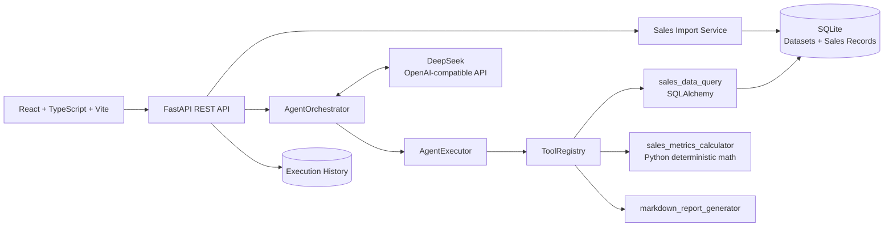

# AgentFlow — Agentic Sales Analytics Platform

**AgentFlow——智能销售数据分析 Agent 平台** is an observable, tool-driven sales analytics application. It connects real Excel/CSV sales data to a DeepSeek-powered Agent that selects registered tools, while Python owns validation, deterministic calculations, persistence, and report generation.

> GitHub Repository: [FaustQAQ/AgentFlow-Sales-Analytics](https://github.com/FaustQAQ/AgentFlow-Sales-Analytics)

## What it does

- Uploads `.xlsx` and `.csv` sales files with preview, field mapping, row-level validation, duplicate detection, formula-injection protection, and import statistics.
- Persists datasets and sales records in SQLite using transactional, additive schema migration.
- Requires an explicit `dataset_id` throughout the Agent execution lifecycle, preventing cross-dataset analysis.
- Uses DeepSeek OpenAI-compatible Function Calling to select `sales_data_query`, `sales_metrics_calculator`, and `markdown_report_generator`.
- Calculates totals, YoY/MoM growth, product rankings, and regional rankings in Python/SQLAlchemy rather than relying on LLM arithmetic.
- Stores execution history, tool arguments, outputs, errors, and final Markdown reports for auditability.

## Real business flow

```text
Excel / CSV upload
        ↓
Preview + header mapping + row validation
        ↓
Atomic SQLite persistence
        ↓
Dataset selected in AgentFlow UI
        ↓
DeepSeek Function Calling
        ↓
sales_data_query → sales_metrics_calculator → markdown_report_generator
        ↓
Traceable Markdown report with source dataset, date range, and record count
```

## Architecture



## Technical highlights

- FastAPI, Pydantic v2, SQLAlchemy 2.x, SQLite, React, TypeScript, Vite.
- Bounded multi-round Agent orchestration with Function Calling, execution context, retries, error classification, and step persistence.
- Additive database migration: existing SQLite data and execution history are preserved; dataset deletion cascades only to sales records and sets execution `dataset_id` to `NULL`.
- CSV/XLSX ingestion through `python-multipart` and `openpyxl`; unsupported formats, empty files, invalid dates/amounts, duplicate orders, and bad rows are reported explicitly.
- API keys stay in the backend `.env`; they are never sent to the frontend or written to logs.

## Project layout

```text
app/api/v1/       FastAPI dataset and execution routes
app/models/       SQLAlchemy execution, dataset, and sales-record models
app/services/     Import, Agent orchestration, LLM, persistence, and query services
app/tools/        Tool base class, registry, and sales analytics tools
frontend/         React + TypeScript + Vite application
tests/            Isolated SQLite and Agent/LLM test suite
docs/             Architecture, API, database, acceptance, learning log, and interview notes
testdata/         Clearly labelled local acceptance workbook
```

## Running locally

```powershell
Copy-Item .env.example .env
# Set LLM_API_KEY in .env; never commit .env.
.venv\Scripts\python.exe -m pip install -r requirements.txt
.venv\Scripts\python.exe -m uvicorn app.main:app --host 127.0.0.1 --port 8800 --reload
```

In another terminal:

```powershell
cd frontend
npm install
$env:VITE_API_BASE_URL="http://127.0.0.1:8800"
npm run dev -- --host 127.0.0.1 --port 5173
```

The default SQLite database is `data/agentflow/.db` relative to the repository root. The main API is available at `http://127.0.0.1:8800`; OpenAPI docs are at `/docs`.

## API surface

- `POST /api/v1/datasets/upload`
- `POST /api/v1/datasets/{dataset_id}/import`
- `GET /api/v1/datasets`
- `GET /api/v1/datasets/{dataset_id}`
- `GET /api/v1/datasets/{dataset_id}/records`
- `DELETE /api/v1/datasets/{dataset_id}`
- `POST /api/v1/executions` with `{ "user_request": "...", "dataset_id": 1 }`
- `GET /api/v1/executions`, `GET /api/v1/executions/{execution_id}`

## Testing and acceptance

The current acceptance run completed the non-HTTP backend suite with **163 passed**. Five HTTP health/API tests remain **BLOCKED** in the managed Windows environment because the local asyncio socket initialization used by the test client does not return; they are not reported as passing.

The browser-level acceptance used [testdata/acceptance_sales.xlsx](testdata/acceptance_sales.xlsx): 6 rows imported, 0 failed rows, real DeepSeek Function Calling, SQLite queries, Python metrics, Markdown report generation, history lookup, and persistence after backend restart.

```powershell
.venv\Scripts\python.exe -m pytest -q --ignore=tests/test_api.py --ignore=tests/test_health.py
cd frontend
npm run build
```

中文学习与开发说明见 [docs/PROJECT_LEARNING_LOG.md](docs/PROJECT_LEARNING_LOG.md)、[docs/DEVELOPMENT.md](docs/DEVELOPMENT.md) 和 [docs/INTERVIEW_QUESTIONS.md](docs/INTERVIEW_QUESTIONS.md)。

## Current scope

AgentFlow is designed for local, auditable analytics workflows. It does not yet include authentication, multi-tenant authorization, streaming responses, or a production-scale asynchronous database layer.
